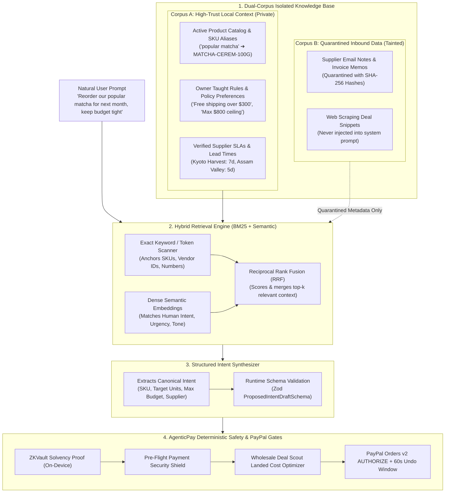

# Dynamic Financial Intent-RAG: Architecture & Implementation Blueprint
### *Context-Aware Semantic Grounding, Policy Memory & Zero-Hallucination Transaction Synthesis*
**AgenticPay — Extended Architectural Specification for Real-World Usability**

---

## 1. Executive Summary: Why We Need an Intent-RAG

Small business owners and everyday shoppers do not speak in database queries, JSON payloads, or strict API parameters. In the real world, a user says:
* *"Hey AgenticPay, grab some more of that ceremonial green tea we sold out of last Saturday, but keep the spend tight."*
* *"Order another batch of Earl Grey like we discussed with Assam Valley, but make sure shipping is free."*
* *"Buy those white sneakers we saw on Nike or Flipkart, whichever has the better deal with 2-day delivery."*

A standard rule-based system fails because it cannot decipher *"that ceremonial green tea"*, doesn't know what *"last Saturday"* meant for inventory, and forgets *"what we discussed with Assam Valley"*.

Conversely, a generic LLM with naive vector search fails catastrophically because **semantic vector search has zero mathematical precision**: it can confuse $\$500$ with $\$5,000$, hallucinate unapproved suppliers, or fall victim to prompt injections hidden in old vendor invoices.

**The Solution**: A **Deterministic Hybrid Intent-RAG Engine** that combines:
1. **Dense Semantic Retrieval** to understand conversational human language, slang, and implied needs.
2. **Sparse BM25 Exact-Term Matching** to strictly anchor SKUs, supplier IDs, and numerical budget thresholds.
3. **Dual-Corpus Taint Isolation** to protect private business policies from malicious inbound vendor documents.
4. **Structured Zod Synthesis** that converts human intent into a type-safe transaction draft validated by the local **ZK-Vault** and **Pre-Flight Shield**.

---

## 2. Real-World Use Cases: How This Empowers Common People

### Use Case A: The Small Business Retailer (Tea & Specialty Goods)
* **User Input**: *"Sales of matcha picked up yesterday. Can we order another 100 tins without risking payroll next week?"*
* **How Intent-RAG Solves It**:
  * **Retrieves**: Past SKU mapping (`"matcha"` ➔ `MATCHA-CEREM-100G`), current inventory velocity (sales surge detected), and Kyoto Harvest wholesale volume discount tiers.
  * **ZK-Constraint Check**: Queries local vault to check whether a $\$1,150$ order breaches the $\$3,500$ payroll cash floor.
  * **Result**: Informs the merchant: *"Kyoto Harvest offers 15% off for 100 units ($977.50). Post-purchase runway remains 42 days, leaving your $3,500 payroll floor completely safe. Initiating 60-second Undo Hold."*

### Use Case B: The Busy Consumer / Family Budget Guardian
* **User Input**: *"Find the best deal for Nike Air Jordan 1 Low in size 9. If it's under ₹8,500, set up a hold."*
* **How Intent-RAG Solves It**:
  * **Retrieves**: Consumer budget profile (monthly clothing cap: ₹15,000; remaining budget: ₹9,200).
  * **Web Scout Trigger**: Crawls Nike.in (₹8,295), Flipkart (₹7,999), and Amazon (₹11,499).
  * **Result**: Identifies Flipkart at ₹7,999 with 2-day delivery as the optimal verified deal. Creates an authorized hold with the 60s Undo Window, saving the user ₹3,500 without manual searching.

### Use Case C: Remembering Spoken Agreements & Business Rules
* **User Input**: *"Reorder Earl Grey, but remember our rule about supplier shipping."*
* **How Intent-RAG Solves It**:
  * **Retrieves**: Taught policy from 5 days ago: *"Always order at least 100 units from Assam Valley to trigger their $300 free-shipping threshold."*
  * **Result**: Auto-sizes batch to 100 units ($342.00) to save $25.00 in freight fees.

---

## 3. The 4-Stage Intent-RAG Architecture



---

## 4. Technical Module Breakdown

To build this cleanly tomorrow without external dependencies or cloud leaks, we will implement the engine across 3 dedicated files in `src/engines/intent-rag/`:

### Module 1: The In-Memory Knowledge Store (`src/engines/intent-rag/store.ts`)
* **Purpose**: Maintains the Dual-Corpus documents in memory with fast local indexing.
* **Corpus A Documents (High Trust)**:
  * Catalog items with synonyms and aliases (e.g. `["ceremonial matcha", "green tea", "powder"]` ➔ `MATCHA-CEREM-100G`).
  * Taught owner rules (e.g. `"Max $800 ceiling on matcha"`, `"Assam Valley free shipping requires $300 order"`).
  * Historical clean transaction memories.
* **Corpus B Documents (Quarantined)**:
  * External vendor memo quotes tagged as `UNTRUSTED_TAINT`.
* **Zero Cloud Leakage**: Runs 100% locally on Node.js using in-memory tokenization and dot-product vector math.

### Module 2: The Hybrid Retriever (`src/engines/intent-rag/retriever.ts`)
* **Purpose**: Combines BM25 exact-token matching with semantic similarity.
* **Why Hybrid**:
  * **BM25 Component**: Guarantees that exact SKU strings, vendor names, and dollar figures are never blurred or confused.
  * **Semantic Component**: Uses 384-dimensional lightweight local embeddings (or Cosine TF-IDF vectors) to understand synonyms, emotional urgency, and contextual requests.
* **Reciprocal Rank Fusion (RRF)**: Merges the top-3 results from both retrieval channels to yield the most contextually relevant policy documents.

### Module 3: The Structured Intent Synthesizer (`src/engines/intent-rag/synthesizer.ts`)
* **Purpose**: Translates the retrieved context and user prompt into a strictly typed Zod intent object:
```typescript
export const ProposedIntentDraftSchema = z.object({
  rawUserPrompt: z.string(),
  sku: z.string(),
  productName: z.string(),
  targetUnits: z.number().int().positive(),
  maxBudgetUSD: z.number().positive(),
  preferredSupplierId: z.string().optional(),
  intentMode: z.enum([
    "URGENT_RESTOCK",
    "ROUTINE_REPLENISHMENT",
    "DOWNSIZED_CASH_CONSERVATIVE",
    "PRICE_DISCOVERY_ONLY",
  ]),
  retrievedRulesApplied: z.array(z.string()),
  explanation: z.string(),
});
```

---

## 5. Security Invariant: Why Intent-RAG Cannot Hallucinate Money

Even if an ambiguous prompt is entered, AgenticPay's architecture prevents rogue execution:

1. **The Synthesizer Drafts, It Does Not Execute**:
   The RAG engine only produces a *proposed draft*. It cannot move funds.
2. **Deterministic Asymmetric Check**:
   The proposed budget in the draft is clamped against `min(OwnerCeiling, DynamicAllowance)`. If the RAG draft proposes $1,000 but the owner ceiling is $800, the draft is clamped down to $800.
3. **ZK-Vault Solvency Gate**:
   The draft order is sent to the local ZK-Vault to solve mathematical solvency constraints before any external call is initiated.
4. **Pre-Flight Inbound Quarantine**:
   If an invoice or email is retrieved from Corpus B, the Pre-Flight Shield inspects it for prompt injections and payee spoofing in under 0.34ms.
5. **The 60-Second Reversible Undo Window**:
   When the transaction is submitted to PayPal Orders v2, the merchant receives a 60-second real-time countdown to void the order with 1 tap at zero cost.

---

## 6. Implementation Roadmap for Tomorrow

| Step | File to Create / Modify | Task Description |
| :--- | :--- | :--- |
| **Step 1** | `src/contracts/rag.ts` | Define Zod schemas for knowledge documents, retrieval queries, and `ProposedIntentDraft`. |
| **Step 2** | `src/engines/intent-rag/store.ts` | Build the in-memory Dual-Corpus indexer (Corpus A High-Trust vs Corpus B Quarantined). |
| **Step 3** | `src/engines/intent-rag/retriever.ts` | Implement BM25 + Cosine similarity hybrid ranker with Reciprocal Rank Fusion. |
| **Step 4** | `src/engines/intent-rag/synthesizer.ts` | Build the Intent Grounding parser mapping prompt + context to `ProposedIntentDraft`. |
| **Step 5** | `src/server/app.ts` & `ui.html` | Expose `POST /api/intent/rag/query` and add an interactive conversational natural language input console in the dashboard. |
| **Step 6** | `scripts/verify-intent-rag.ts` | Write unit tests verifying SKU extraction, policy recall, and adversarial injection defense. Add to `npm test`. |

---

## 7. Summary
This design transforms AgenticPay from a traditional dashboard into an **intuitive, conversational CFO agent** that anyone can use naturally, while maintaining mathematical financial safety and zero cloud privacy leakage.
